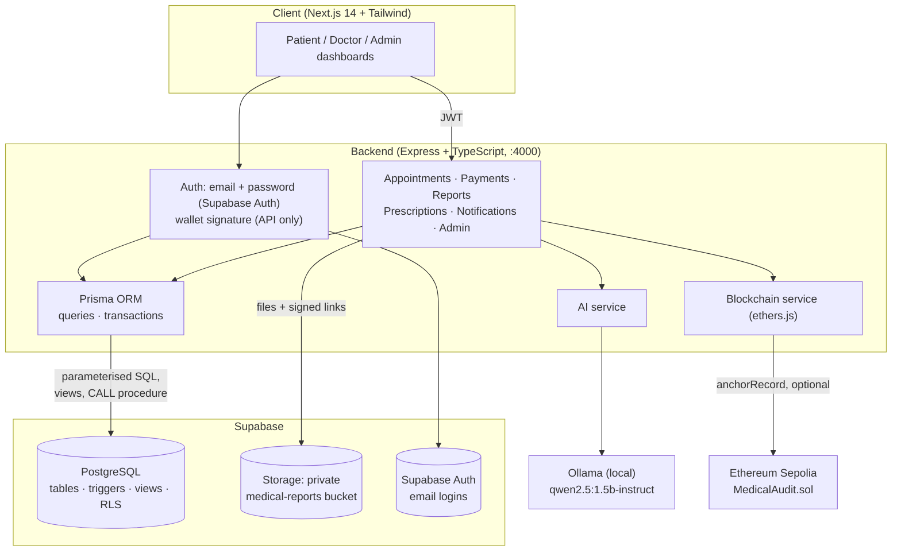

# 🩺 ELIXOR

> **A healthcare management platform built on a strictly designed PostgreSQL database: appointment booking, consultation payments, prescriptions, AI-summarised lab reports, and tamper-evident document anchoring on Ethereum.**

ELIXOR (originally *HealthChain*) is a DBMS-focused full-stack project. Patients book doctors and pay consultation fees, doctors manage their queue and issue prescriptions, admins run the platform. Underneath, the database does the heavy lifting: normalised tables, constraints, triggers, analytical views and row-level security.

[](https://nextjs.org/)
[](https://expressjs.com/)
[](https://supabase.com/)
[](https://www.prisma.io/)
[-000000)](https://ollama.com/)
[](https://soliditylang.org/)

---

## 📌 Contents

- [Features by role](#-features-by-role)
- [Architecture](#-architecture)
- [Core workflows](#-core-workflows)
- [Database design](#-database-design)
- [Smart contract](#-smart-contract-medicalauditsol)
- [API reference](#-api-reference)
- [Repository structure](#-repository-structure)
- [Getting started](#-getting-started)
- [Environment variables](#-environment-variables)
- [Demo data](#-demo-data)
- [Checks and tests](#-checks-and-tests)
- [Docker](#-docker)
- [Backup and restore](#-backup-and-restore)
- [CI/CD and deployment](#-cicd-and-deployment)
- [Git workflow](#-git-workflow)
- [Current status and limitations](#-current-status-and-limitations)
- [FAQ](#-faq)
- [Roadmap](#-roadmap)

---

## 🌟 Features by role

| Role | What they can do |
| :--- | :--- |
| **Patient** | Register and sign in with email · keep a **health profile** (allergies, blood group, date of birth, emergency contact) · book appointments, filtering doctors by specialization · pay the consultation fee once the doctor accepts (simulated checkout with receipt) · view prescriptions with the prescribing doctor · upload medical reports (PDF/images) and get an AI summary from the report text · open their uploaded PDFs through short-lived links · see notifications |
| **Doctor** | Register with specialization, license number and consultation fee · see their own patient queue with payment status and **patient allergies** · **accept, decline or complete** appointments · write prescriptions · see notifications for new requests |
| **Admin** | Platform dashboard with 12 live metrics (patients, doctors, appointments, reports, AI analyses, blockchain anchors, revenue, paid consultations, awaiting payment, refunds) and a weekly doctor-load chart · **user management** with server-side search, status filter and pagination: deactivate/reactivate or permanently delete patients and doctors, with affected patients notified automatically |

Everyone gets a 🔔 notification bell with an unread count.

---

## 🏗️ Architecture



**Database access goes through Prisma.** Every table read and write uses the Prisma ORM client (`backend/src/config/prisma.ts`); supabase-js is only used for file Storage and Supabase Auth. After login the backend issues a JWT carrying `app_user_id` and `app_role`. Role middleware guards each route, and every Prisma query is scoped with a `where` built from those claims. The backend also checks on every request that the account is still active, so a deactivated user loses access immediately. Postgres RLS policies remain as a second layer for any client that connects with a user token.

---

## 🔄 Core workflows

### 1. Booking and accepting appointments
1. A patient picks a specialization and doctor and requests a time (`requested`). The doctor is notified by a database trigger.
2. The doctor accepts (`confirmed`), declines (`cancelled`) or later completes the visit. The patient is notified each time, with times shown in IST.

### 2. Consultation payments (simulated)
1. Booking is free. Once a visit is `confirmed` (or `completed`), the patient sees **Pay ₹X**.
2. Checkout offers UPI, card or net banking and is clearly marked as test mode: **no gateway is called and no payment details are collected**.
3. The server always takes the amount from the doctor's `consultation_fee`, never from the browser. Checkout runs as one transaction that locks the appointment row (`SELECT … FOR UPDATE`), and one payment per appointment is also enforced by a unique constraint.
4. If a paid appointment is later cancelled, the trigger `trg_refund_on_cancel` marks the payment `refunded`.

### 3. Medical reports and AI summaries
1. The patient uploads a file (≤ 15 MB). It goes to the private `medical-reports` bucket and its SHA-256 hash is stored with the report.
2. If the patient pastes the report's text, it is sent to the AI model, which returns a JSON summary, flagged findings, severity and confidence. Locally this is an **Ollama model** (`qwen2.5:1.5b-instruct`); the deployed server has no Ollama, so it uses a hosted model on **Groq's free API** (`AI_PROVIDER=openai-compatible`). Claude through the Anthropic API (`AI_PROVIDER=claude`) is also supported. The result is validated and stored in `ai_analyses`.
3. The upload message reports what actually happened: AI summary added, skipped (no text) or failed, and whether the file was anchored.
4. **View PDF** asks the backend for the file. It checks the viewer may see the report (patient, assigned doctor or admin) and returns a signed link that expires after 60 seconds.

> The AI never sees the PDF itself, only the text the patient provides. No real patient data is needed to demo it.

### 4. Tamper-evident anchoring on Ethereum
When `BLOCKCHAIN_ENABLED=true`, the SHA-256 hash of each report file (and of each prescription's medications, serialised in a fixed order) is written to `MedicalAudit.anchorRecord()`, and the transaction is tracked in `blockchain_transactions` along with the chain it's on (`hardhat-local` or `sepolia`). Documents never go on-chain. With anchoring off, cards honestly show **Not anchored**.

**🔍 Verify integrity** (on anchored reports and prescriptions) re-hashes the record on the server, from the stored file or the current medications, and compares it with the hash recorded at upload and the hash held by the contract. It reports **Verified**, **Tampering detected** (file swapped or medications edited after anchoring) or why it couldn't check (anchoring off, chain not running).

### 5. Admin user management
- **Deactivate** blocks sign-in, hides a doctor from booking, cancels the user's upcoming visits (refunding paid ones) and keeps every record. **Reactivate** restores access.
- **Delete permanently** (type `DELETE` to confirm) removes the user and, through cascades, their appointments, prescriptions, reports, payments, files and Supabase Auth login. Audit-log rows are kept with the user link cleared.
- When a **doctor** is deactivated or deleted, every patient with an appointment with them gets one notification; those with upcoming visits are told they were cancelled (and refunded), and on deletion are asked to choose a different doctor.

---

## 💾 Database design

The schema lives in `db/migrations/` (also bundled into `db/ALL_IN_ONE_SETUP.sql`). The **ER diagram, relational schema, data dictionary and normalization proof** are in [`docs/DATABASE_DESIGN.md`](docs/DATABASE_DESIGN.md); the project proposal and Gantt chart are in [`docs/PROJECT_PROPOSAL.md`](docs/PROJECT_PROPOSAL.md). A plain-language walkthrough of the whole project, with a rubric checklist and likely viva questions, is in [`docs/ELIXOR_Project_Overview.pdf`](docs/ELIXOR_Project_Overview.pdf).

### Tables (3NF / BCNF)
`users` · `doctor_profiles` · `patient_profiles` · `appointments` · `payments` · `medical_reports` · `ai_analyses` · `prescriptions` · `prescription_items` · `blockchain_transactions` · `notifications` · `audit_logs` · `auth_nonces` (13 tables, 17 foreign keys)

All users are in **one** `users` table with a `role` column; role-specific data lives in 1:1 profile tables instead of nullable columns on `users`. Each medicine on a prescription is its own `prescription_items` row, and `payments` reaches the patient and doctor through its appointment (no transitive dependency). Append-only data (AI analyses, chain transactions, audit logs) sits in its own tables with foreign keys.

### Constraints
| Constraint | Rule |
| :--- | :--- |
| `chk_file_hash_format` | report hashes are 64-char hex SHA-256 |
| `blood_group` check | only `A±`, `B±`, `AB±`, `O±` |
| `chk_appt_roles`, `chk_presc_roles` | nobody books or prescribes for themselves |
| `uq_prescription_line`, `duration_days > 0` | medicines are numbered once per prescription, durations are positive |
| `chk_one_target` | a chain transaction references exactly one report *or* prescription |
| `payments.appointment_id` unique | one payment per appointment |
| `amount > 0`, `chk_refund_time` | refunds always carry a timestamp, paid rows never do |
| `doctor_profiles.license_number` unique | no duplicate licenses |

### Triggers
| Trigger | What it does |
| :--- | :--- |
| `trg_users_updated_at`, `trg_appointments_updated_at` | maintain `updated_at` |
| `fn_audit_trigger` on reports, prescriptions, appointments, payments, user role changes | writes operation, table and full old/new JSON to `audit_logs` |
| `trg_check_appt_roles` | `doctor_id` must be a doctor, `patient_id` a patient |
| `trg_notify_appointment`, `trg_notify_report`, `trg_notify_prescription` | create notifications (times in IST) |
| `trg_refund_on_cancel` | cancelling a paid appointment refunds it |
| `trg_check_prescription_appointment` | a prescription linked to a visit must have that visit's patient and doctor |

The audit, notification, role-check and refund trigger functions are `SECURITY DEFINER` (migrations 006, 008, 009) so their system writes, such as audit rows, aren't blocked by the user's RLS.

### Views
| View | Purpose |
| :--- | :--- |
| `v_patient_dashboard` / `v_doctor_dashboard` | appointments pre-joined with names, specialization and report counts |
| `v_report_with_analysis` | each report with its latest AI analysis and chain status |
| `v_admin_analytics` | platform-wide metrics, including revenue and refunds |
| `v_doctor_weekly_load` | appointments per doctor per week |

Views run with their owner's rights, so the backend filters view results to the signed-in user.

### Stored procedure
`sp_create_prescription(doctor, patient, appointment, notes, items jsonb, INOUT id)` inserts a prescription and all its `prescription_items` rows as one unit. The backend calls it inside a Prisma transaction from `POST /api/prescriptions`.

### Transactions
Multi-step writes run in one `prisma.$transaction`, so they commit or roll back together: doctor registration (user + profile), checkout (row lock + payment), issuing a prescription (procedure call), deactivating a user (notifications + account + appointment cancellations) and deleting a doctor. The helper `withAuditUser()` also sets `app.current_user_id` for the transaction, so `audit_logs` records who made each change.

### Indexes
B-tree indexes on every foreign key and common filter/sort column, partial index for unused sign-in nonces, `pg_trgm` GIN indexes for the admin name/email search, IVFFlat for vector search. Full list in [`docs/DATABASE_DESIGN.md`](docs/DATABASE_DESIGN.md#7-indexes).

### Row-level security
Every table has RLS enabled. Patients see only their own rows, doctors see rows for their own patients, admins see everything, notifications are owner-only, and `auth_nonces` is closed to public roles (backend only). The backend's Prisma connection is the table owner and enforces the same rules in its queries; RLS protects any other client.

### Migrations
| File | Change |
| :--- | :--- |
| `001`–`005` | core schema, triggers, views, RLS, pgvector match function |
| `006_trigger_security_definer` | trigger functions run as owner so RLS doesn't block audit/notification writes |
| `007_auth_nonces_rls` | lock down sign-in nonces |
| `008_payments` | payments table, refund trigger, payment metrics in admin analytics |
| `009_appointment_notifications` | IST times; no duplicate notices when a doctor is deactivated |
| `010_blockchain_tx_cascade` | chain transactions are removed with their document (fixes deleting anchored records) |
| `011_report_chain_view` | report view uses the latest anchor attempt and exposes its chain; removes the placeholder seed transaction |
| `012_normalize_and_procedures` | `prescription_items` table (1NF), drops the transitively dependent payment columns (3NF), prescription/appointment consistency trigger, `sp_create_prescription`, search and paging indexes |

---

## 📜 Smart contract (`MedicalAudit.sol`)

Solidity `0.8.24`, deployed with Hardhat to Sepolia.

```solidity
function anchorRecord(bytes32 recordId, bytes32 dataHash, string calldata recordType) external onlyAuthorized;
function verifyRecord(bytes32 recordId, bytes32 dataHash) external view returns (bool);
function getRecord(bytes32 recordId) external view returns (AuditRecord memory);
```

- Stores only a 32-byte hash, the submitter and a timestamp per record. No health data.
- Records can't be overwritten: re-anchoring the same `recordId` reverts.
- Only the owner and authorised backend signers can anchor.

---

## 📡 API reference

All routes except `/health` and `/api/auth/*` need `Authorization: Bearer <token>`. List endpoints marked *paginated* take `?page=` (default 1) and `?page_size=` (default 10, max 100) and return `{ items, total, page, page_size, total_pages }`. Validation errors return `400`, missing access `403`/`404`, duplicates `409`.

### Auth — `/api/auth`
| Method | Path | Description |
| :--- | :--- | :--- |
| `POST` | `/register` | email sign-up as patient or doctor (doctors also send `specialization`, `license_number`, `consultation_fee`) |
| `POST` | `/login` | email + password login |
| `GET` | `/me` | the signed-in user (role, status, doctor profile), read fresh from the database; the frontend's `RoleGate` uses it to allow or redirect each dashboard |
| `POST` | `/nonce`, `/verify` | wallet sign-in: get a one-time message, then verify its signature (`admin_key` optionally grants admin) |
| `POST` | `/demo` | role switcher for local demos, only when `NODE_ENV=development` |

### Appointments — `/api/appointments`
| Method | Path | Description |
| :--- | :--- | :--- |
| `GET` | `/doctors` | active doctors with specialization (patients only) |
| `GET` | `/` | the signed-in patient's or doctor's appointments, with fee and payment |
| `POST` | `/` | request an appointment (patients) |
| `PATCH` | `/:id/status` | `confirmed` / `completed` / `cancelled` / `no_show` (assigned doctor or admin) |

### Payments — `/api/payments`
| Method | Path | Description |
| :--- | :--- | :--- |
| `POST` | `/` | pay for a confirmed or completed appointment (`{ appointment_id, method }`; patients only) |

### Reports — `/api/reports`
| Method | Path | Description |
| :--- | :--- | :--- |
| `POST` | `/` | upload (multipart `file`, `patient_id`, `title`, `report_type`, optional `raw_text`); stores, hashes, analyses, optionally anchors |
| `GET` | `/` | *paginated* reports visible to the user, with AI summary, chain status and `has_file` |
| `GET` | `/:id` | one report |
| `GET` | `/:id/file` | 60-second signed link to the stored file |
| `GET` | `/:id/verify` | integrity check: stored file vs upload hash vs on-chain hash |

### Prescriptions — `/api/prescriptions`
| Method | Path | Description |
| :--- | :--- | :--- |
| `GET` | `/` | *paginated* prescriptions visible to the user, with medicines, patient/doctor names and chain transactions |
| `POST` | `/` | issue a prescription (doctors, admins) via `sp_create_prescription` |
| `GET` | `/:id/verify` | integrity check: current medications vs on-chain hash |

### Patients — `/api/patients` (patients only)
| Method | Path | Description |
| :--- | :--- | :--- |
| `GET` | `/me/profile` | the signed-in patient's health profile |
| `PUT` | `/me/profile` | create or update it (`date_of_birth`, `blood_group`, `allergies`, `emergency_contact`) |

### Notifications — `/api/notifications`
| Method | Path | Description |
| :--- | :--- | :--- |
| `GET` | `/` | latest 50 notifications for the user |
| `PATCH` | `/read-all`, `/:id/read` | mark all / one as read |

### Admin — `/api/admin` (admins only)
| Method | Path | Description |
| :--- | :--- | :--- |
| `GET` | `/analytics`, `/doctor-load` | dashboard aggregates (from views) |
| `GET` | `/audit-logs` | *paginated* audit trail |
| `GET` | `/users` | *paginated* patients or doctors: `?role=patient\|doctor&q=<search>&status=all\|active\|inactive`, with linked record counts |
| `PATCH` | `/users/:id/active` | deactivate / reactivate (`{ is_active }`) |
| `DELETE` | `/users/:id` | permanent delete |
| `PATCH` | `/users/:id/role` | change a user's role |

---

## 📂 Repository structure

```text
├── backend/              Express + TypeScript API (Dockerfile)
│   ├── prisma/           schema.prisma: Prisma ORM models for every table
│   └── src/
│       ├── config/       Prisma client + transaction helper, Supabase client (storage/auth only)
│       ├── middleware/   JWT issue/verify, active-account check, role guards, error handler
│       ├── routes/       auth, appointments, payments, reports, prescriptions, patients, notifications, admin
│       ├── services/     ai (Ollama), blockchain (ethers), payments
│       ├── utils/        pagination
│       └── scripts/      anchor-backfill (anchors existing records)
├── frontend/             Next.js 14 app (Dockerfile)
│   └── src/
│       ├── app/          / (login + landing), /patient, /doctor, /admin
│       ├── components/   DashboardHeader, NotificationBell, UserManagement, Pager
│       └── lib/          API client, payments helpers, specializations list
├── db/
│   ├── migrations/       001–012
│   ├── seed/             seed.sql, demo_seed.sql, demo_payments.sql
│   └── ALL_IN_ONE_SETUP.sql
├── contracts/            Hardhat project: MedicalAudit.sol, tests, Sepolia deploy and local-chain setup scripts
├── scripts/              db-backup.sh / db-restore.sh (pg_dump / pg_restore)
├── docs/                 DATABASE_DESIGN.md (ER diagram, schema, data dictionary), PROJECT_PROPOSAL.md (Gantt), presentation notes
├── ai/                   standalone Python RAG demo (OpenAI-based, for presentations)
├── docker-compose.yml    backend + frontend containers
├── render.yaml           Render blueprint for the backend
└── .github/workflows/    CI: typecheck, build, contract tests, Docker images
```

---

## 🚀 Getting started

### Prerequisites
- Node.js 20+
- A Supabase project
- [Ollama](https://ollama.com/download) for AI summaries (optional; everything else works without it)

### 1. Database (Supabase)
1. In the **SQL Editor**, run `db/ALL_IN_ONE_SETUP.sql` (schema, triggers, views, RLS, migrations 006–012 and base seed data).
2. Optionally run `db/seed/demo_seed.sql`, then `db/seed/demo_payments.sql`, for a realistic demo dataset.
3. Create a **private** storage bucket named `medical-reports` (Storage → New bucket), or run:
   ```sql
   insert into storage.buckets (id, name, public, file_size_limit)
   values ('medical-reports', 'medical-reports', false, 15728640);
   ```
4. Note your project URL, anon key and service-role key (Project Settings → API), and the **Session pooler** connection string (**Connect** button at the top of the dashboard) for `DATABASE_URL`.

### 2. AI model (optional)
```bash
ollama pull qwen2.5:1.5b-instruct
```
Ollama runs in the background after installing; the backend talks to it at `http://127.0.0.1:11434`.

### 3. Backend
```bash
cd backend
cp .env.example .env     # fill in the values below (DATABASE_URL, SUPABASE_*, JWT_SECRET)
npm install              # also runs `prisma generate`
npm run dev              # http://localhost:4000 (GET /health checks the database too)
```

### 4. Frontend
```bash
cd frontend
cp .env.local.example .env.local
npm install
npm run dev              # http://localhost:3000
```

### 5. Blockchain anchoring (optional)

**Local Hardhat chain** (no accounts or test ETH needed):
```bash
cd contracts
npm install
npm test                  # 6 contract tests
npm run node              # keep running: local chain on http://127.0.0.1:8545
npm run setup:local       # in another terminal: deploys, authorises the backend signer, writes AUDIT_CONTRACT_ADDRESS to backend/.env
```
Then in `backend/.env` set `SEPOLIA_RPC_URL=http://127.0.0.1:8545`, a Hardhat test account key as `AUDIT_SIGNER_PRIVATE_KEY` and `BLOCKCHAIN_ENABLED=true`, restart the backend, and anchor existing records with:
```bash
cd backend
npm run anchor:backfill
```
A local chain starts empty each time `npm run node` restarts: run `setup:local`, restart the backend and run `anchor:backfill` again.

**Sepolia:** set a real RPC URL and a funded test-wallet key in `contracts/.env` and `backend/.env`, run `npm run deploy:sepolia`, put the printed address in `AUDIT_CONTRACT_ADDRESS`, and set `BLOCKCHAIN_ENABLED=true`. Transactions then link to Sepolia Etherscan.

---

## ⚙️ Environment variables

### `backend/.env`
| Variable | Required | Purpose |
| :--- | :---: | :--- |
| `PORT` | | API port (default `4000`) |
| `NODE_ENV` | | `development` enables `/api/auth/demo` |
| `DATABASE_URL` | ✅ | Postgres connection string used by Prisma (Supabase **Session pooler** URI, port 5432) |
| `JWT_SECRET` | ✅ | signs the API's login tokens; use a long random string (set it to the Supabase JWT secret if you also want the tokens accepted by RLS) |
| `SUPABASE_URL` | ✅ | project URL |
| `SUPABASE_SERVICE_ROLE_KEY` | ✅ | server-only key for Storage and Auth admin calls |
| `SUPABASE_ANON_KEY` | ✅ | used for password login |
| `FRONTEND_ORIGIN` | ✅ | CORS origin, e.g. `http://localhost:3000` |
| `AI_PROVIDER` | | `ollama` (default, local model), `openai-compatible` (hosted OpenAI-format API, e.g. Groq's free tier; used on the deployed server) or `claude` (Anthropic API) |
| `OLLAMA_URL` | | default `http://127.0.0.1:11434` |
| `LOCAL_CHAT_MODEL` | | default `qwen2.5:1.5b-instruct` |
| `AI_API_KEY` | when `AI_PROVIDER=openai-compatible` | API key, e.g. from console.groq.com |
| `AI_BASE_URL` | | default `https://api.groq.com/openai/v1` |
| `AI_MODEL` | | default `openai/gpt-oss-120b`; if the model is not available to the key, the backend picks one from `/models` |
| `ANTHROPIC_API_KEY` | when `AI_PROVIDER=claude` | Anthropic API key |
| `CLAUDE_MODEL` | | default `claude-opus-5-5` |
| `BLOCKCHAIN_ENABLED` | | `true` to anchor hashes on-chain |
| `SEPOLIA_RPC_URL`, `AUDIT_CONTRACT_ADDRESS`, `AUDIT_SIGNER_PRIVATE_KEY` | when anchoring | RPC endpoint (Sepolia, or `http://127.0.0.1:8545` for the local chain), deployed contract, authorised signer |
| `ADMIN_REGISTRATION_KEY` | | passcode that lets a wallet sign-in become admin |

### `frontend/.env.local`
| Variable | Purpose |
| :--- | :--- |
| `NEXT_PUBLIC_API_URL` | backend URL, e.g. `http://localhost:4000` |

Never commit real `.env` files; `.gitignore` excludes them.

---

## 🧪 Demo data

`demo_seed.sql` adds 8 doctors across specializations (Dermatology, Orthopedics, Pediatrics, Neurology, Gynecology & Obstetrics, Endocrinology, Psychiatry, Pulmonology), 6 patients with profiles, ~20 appointments between late September and mid November 2026, prescriptions, and lab/imaging reports with hand-written AI summaries (tagged `model_used = 'demo-seed'`). `demo_payments.sql` marks most completed visits as paid. Neither script creates blockchain transactions, so nothing pretends to be anchored; run `npm run anchor:backfill` to anchor them for real.

Demo accounts are plain database rows. To let them sign in through the login form, create Supabase Auth users with the same emails (Authentication → Users → Add user); the login route links an Auth account to the existing user by email. Keep any shared demo password in a git-ignored file such as `*.local.md`.

---

## ✅ Checks and tests

```bash
cd backend && npx prisma validate && npm run typecheck && npm run build   # ORM schema, typecheck, compile
cd frontend && npx tsc --noEmit && npm run build                          # typecheck, production build
cd contracts && npm test                                                  # contract tests
```

The same checks run in GitHub Actions on every push and pull request.

---

## 🐳 Docker

Both apps have a multi-stage `Dockerfile`; `docker-compose.yml` runs them together against the Supabase database in `backend/.env`.

```bash
docker compose up --build          # frontend http://localhost:3000, backend http://localhost:4000/health
```

Publish the images to Docker Hub:

```bash
docker login
DOCKERHUB_USER=<your-dockerhub-name> docker compose build
DOCKERHUB_USER=<your-dockerhub-name> docker compose push
```

CI also builds both images on every push and pushes them to Docker Hub from `main` once the repository secrets `DOCKERHUB_USERNAME` and `DOCKERHUB_TOKEN` are set.

---

## 💽 Backup and restore

Backups use PostgreSQL's native tools (`pg_dump` / `pg_restore`, version 17+). The scripts read `DATABASE_URL` from `backend/.env` and fall back to the `postgres:17-alpine` Docker image when the tools aren't installed.

```bash
bash scripts/db-backup.sh                                   # -> backups/elixor_<timestamp>.dump
pg_restore --list backups/elixor_<timestamp>.dump           # inspect what's inside
RESTORE_URL=<scratch-db-url> bash scripts/db-restore.sh backups/elixor_<timestamp>.dump
```

The dump covers the `public` schema: tables, data, constraints, indexes, views, functions, the stored procedure, triggers and RLS policies. `backups/` is git-ignored because dumps contain real data. Restore uses `--clean --if-exists --single-transaction`, so a failed restore leaves the target unchanged.

---

## 🚢 CI/CD and deployment

- **CI** (`.github/workflows/ci.yml`): backend Prisma validation, typecheck and build; frontend typecheck and build; contract tests; Docker image builds (and pushes from `main`).
- **Database:** Supabase managed PostgreSQL.
- **Backend:** Render, using `render.yaml` (Render → New → Blueprint). Enter `DATABASE_URL`, `SUPABASE_*`, `FRONTEND_ORIGIN` and `ADMIN_REGISTRATION_KEY` in the Render dashboard.
- **Frontend:** Vercel, project root `frontend`, environment variable `NEXT_PUBLIC_API_URL=<Render backend URL>`.
- **Live URL:** _add after deploying_

---

## 🌿 Git workflow

- `main` holds released code; `dev` is the integration branch. Feature branches are merged into `dev` through pull requests, and `dev` is merged into `main` for releases.
- Commit messages describe the change in the imperative ("Add prescription items table").
- Secrets stay out of git: `.env`, `.env.*` and `.env <anything>` files, and `backups/`, are ignored.

---

## 📍 Current status and limitations

| Area | Status |
| :--- | :--- |
| Email auth, booking, accept/decline, prescriptions, payments, notifications, admin user management | ✅ working |
| Prisma ORM for all table access, transactions, stored procedure | ✅ |
| Search, filtering and pagination | ✅ admin users (server-side search/filter/pages), prescriptions and reports (pages) |
| AI summaries | ✅ locally with Ollama, on the live server with Groq's free API; needs the report text pasted in (no OCR) |
| View uploaded PDFs | ✅ via 60-second signed links |
| Blockchain anchoring and integrity checks | ✅ on a local Hardhat chain (`npm run node` must be running); Sepolia supported but not deployed |
| Wallet (MetaMask) sign-in | API supported; not shown on the login page |
| pgvector retrieval (RAG) | schema and `match_patient_analyses()` exist, but the current AI service doesn't store embeddings or retrieve history |
| Payments | simulated only, no real gateway |
| Doctor verification | not implemented: anyone can register as a doctor |
| Doctor view of patient reports | no reports list on the doctor dashboard yet |

---

## 🎯 FAQ

**Why anchor only a hash instead of storing documents on Ethereum?**
Health data on a public chain is a privacy and compliance problem (HIPAA, GDPR's right to erasure) and expensive in gas. Keeping files in private storage and anchoring only their SHA-256 hash gives tamper evidence without exposing anything.

**Where is access enforced?**
In the API: role middleware on each route, and every Prisma query scoped to the signed-in user. Postgres RLS policies add a second layer for any client connecting with a user token. Business rules such as refunds, auditing and role checks live in triggers, so they hold no matter which code path writes the data.

**Why Prisma plus raw SQL for some queries?**
Prisma handles all ordinary reads and writes with type-safe, parameterised queries. Views and the stored procedure are database features Prisma has no builder for, so they are reached through Prisma's tagged-template raw queries, which still send every value as a bind parameter (no SQL injection).

**Why a local model instead of a hosted AI API?**
Report text never leaves the machine running the backend, there are no API keys or costs for a demo, and the model's output is validated against a strict JSON shape before it's stored.

**Why pgvector instead of a separate vector database?**
It keeps embeddings next to the relational data in one system with one backup and transactional consistency. It's in the schema, ready for the retrieval step on the roadmap.

---

## 🗺️ Roadmap

- [ ] Deploy `MedicalAudit.sol` to Sepolia for permanent, publicly checkable anchors
- [ ] Store embeddings and use `match_patient_analyses()` so summaries consider a patient's history
- [ ] Server-side text extraction (OCR) from uploaded PDFs and scans
- [ ] Doctor verification workflow for new doctor accounts
- [ ] Reports view on the doctor dashboard
- [ ] Real payment gateway (e.g. Razorpay test mode)
- [ ] Background job queue for AI and anchoring instead of inline requests
