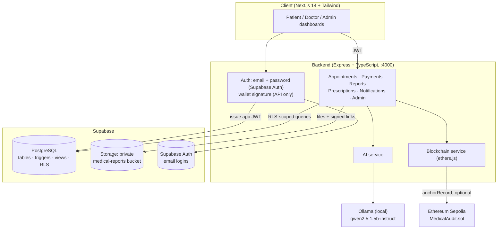

# 🩺 ELIXOR

> **A healthcare management platform built on a strictly designed PostgreSQL database: appointment booking, consultation payments, prescriptions, AI-summarised lab reports, and tamper-evident document anchoring on Ethereum.**

ELIXOR (originally *HealthChain*) is a DBMS-focused full-stack project. Patients book doctors and pay consultation fees, doctors manage their queue and issue prescriptions, admins run the platform. Underneath, the database does the heavy lifting: normalised tables, constraints, triggers, analytical views and row-level security.

[](https://nextjs.org/)
[](https://expressjs.com/)
[](https://supabase.com/)
[-000000)](https://ollama.com/)
[](https://soliditylang.org/)

---

## 📌 Contents

- [Features by role](#-features-by-role)
- [Architecture](#-architecture)
- [Core workflows](#-core-workflows)
- [Database design](#-database-design)
- [Smart contract](#-smart-contract-medicalauditsol)
- [API reference](#-api-reference)
- [Repository structure](#-repository-structure)
- [Getting started](#-getting-started)
- [Environment variables](#-environment-variables)
- [Demo data](#-demo-data)
- [Checks and tests](#-checks-and-tests)
- [Current status and limitations](#-current-status-and-limitations)
- [FAQ](#-faq)
- [Roadmap](#-roadmap)

---

## 🌟 Features by role

| Role | What they can do |
| :--- | :--- |
| **Patient** | Register and sign in with email · book appointments, filtering doctors by specialization · pay the consultation fee once the doctor accepts (simulated checkout with receipt) · view prescriptions with the prescribing doctor · upload medical reports (PDF/images) and get an AI summary from the report text · open their uploaded PDFs through short-lived links · see notifications |
| **Doctor** | Register with specialization, license number and consultation fee · see their own patient queue with payment status · **accept, decline or complete** appointments · write prescriptions · see notifications for new requests |
| **Admin** | Platform dashboard with 12 live metrics (patients, doctors, appointments, reports, AI analyses, blockchain anchors, revenue, paid consultations, awaiting payment, refunds) and a weekly doctor-load chart · **user management**: deactivate/reactivate or permanently delete patients and doctors, with affected patients notified automatically |

Everyone gets a 🔔 notification bell with an unread count.

---

## 🏗️ Architecture



**One token, two consumers.** After login the backend issues a JWT carrying `app_user_id` and `app_role`, signed with the same secret Supabase uses. The API uses it to authorise requests, and Postgres reads the same claims through `auth.jwt()` in its RLS policies. The backend also checks on every request that the account is still active, so a deactivated user loses access immediately.

---

## 🔄 Core workflows

### 1. Booking and accepting appointments
1. A patient picks a specialization and doctor and requests a time (`requested`). The doctor is notified by a database trigger.
2. The doctor accepts (`confirmed`), declines (`cancelled`) or later completes the visit. The patient is notified each time, with times shown in IST.

### 2. Consultation payments (simulated)
1. Booking is free. Once a visit is `confirmed` (or `completed`), the patient sees **Pay ₹X**.
2. Checkout offers UPI, card or net banking and is clearly marked as test mode: **no gateway is called and no payment details are collected**.
3. The server always takes the amount from the doctor's `consultation_fee`, never from the browser. One payment per appointment is enforced by a unique constraint.
4. If a paid appointment is later cancelled, the trigger `trg_refund_on_cancel` marks the payment `refunded`.

### 3. Medical reports and AI summaries
1. The patient uploads a file (≤ 15 MB). It goes to the private `medical-reports` bucket and its SHA-256 hash is stored with the report.
2. If the patient pastes the report's text, it is sent to a **local Ollama model** (`qwen2.5:1.5b-instruct`), which returns a JSON summary, flagged findings, severity and confidence. The result is validated and stored in `ai_analyses`.
3. The upload message reports what actually happened: AI summary added, skipped (no text) or failed, and whether the file was anchored.
4. **View PDF** asks the backend for the file. It checks the viewer may see the report (patient, assigned doctor or admin) and returns a signed link that expires after 60 seconds.

> The AI never sees the PDF itself, only the text the patient provides. No real patient data is needed to demo it.

### 4. Tamper-evident anchoring on Ethereum
When `BLOCKCHAIN_ENABLED=true`, the SHA-256 hash of each report file (and of each prescription's medications, serialised in a fixed order) is written to `MedicalAudit.anchorRecord()`, and the transaction is tracked in `blockchain_transactions` along with the chain it's on (`hardhat-local` or `sepolia`). Documents never go on-chain. With anchoring off, cards honestly show **Not anchored**.

**🔍 Verify integrity** (on anchored reports and prescriptions) re-hashes the record on the server, from the stored file or the current medications, and compares it with the hash recorded at upload and the hash held by the contract. It reports **Verified**, **Tampering detected** (file swapped or medications edited after anchoring) or why it couldn't check (anchoring off, chain not running).

### 5. Admin user management
- **Deactivate** blocks sign-in, hides a doctor from booking, cancels the user's upcoming visits (refunding paid ones) and keeps every record. **Reactivate** restores access.
- **Delete permanently** (type `DELETE` to confirm) removes the user and, through cascades, their appointments, prescriptions, reports, payments, files and Supabase Auth login. Audit-log rows are kept with the user link cleared.
- When a **doctor** is deactivated or deleted, every patient with an appointment with them gets one notification; those with upcoming visits are told they were cancelled (and refunded), and on deletion are asked to choose a different doctor.

---

## 💾 Database design

The schema lives in `db/migrations/` (also bundled into `db/ALL_IN_ONE_SETUP.sql`).

### Tables (3NF)
`users` · `doctor_profiles` · `patient_profiles` · `appointments` · `payments` · `medical_reports` · `ai_analyses` · `prescriptions` · `blockchain_transactions` · `notifications` · `audit_logs` · `auth_nonces`

Role-specific data lives in 1:1 profile tables instead of nullable columns on `users`. Append-only data (AI analyses, chain transactions, audit logs) sits in its own tables with foreign keys.

### Constraints
| Constraint | Rule |
| :--- | :--- |
| `chk_file_hash_format` | report hashes are 64-char hex SHA-256 |
| `blood_group` check | only `A±`, `B±`, `AB±`, `O±` |
| `chk_appt_roles`, `chk_presc_roles`, `chk_payment_roles` | nobody books, prescribes for or pays themselves |
| `chk_one_target` | a chain transaction references exactly one report *or* prescription |
| `payments.appointment_id` unique | one payment per appointment |
| `amount > 0`, `chk_refund_time` | refunds always carry a timestamp, paid rows never do |
| `doctor_profiles.license_number` unique | no duplicate licenses |

### Triggers
| Trigger | What it does |
| :--- | :--- |
| `trg_users_updated_at`, `trg_appointments_updated_at` | maintain `updated_at` |
| `fn_audit_trigger` on reports, prescriptions, appointments, payments, user role changes | writes operation, table and full old/new JSON to `audit_logs` |
| `trg_check_appt_roles` | `doctor_id` must be a doctor, `patient_id` a patient |
| `trg_notify_appointment`, `trg_notify_report`, `trg_notify_prescription` | create notifications (times in IST) |
| `trg_refund_on_cancel` | cancelling a paid appointment refunds it |

The audit, notification, role-check and refund trigger functions are `SECURITY DEFINER` (migrations 006, 008, 009) so their system writes, such as audit rows, aren't blocked by the user's RLS.

### Views
| View | Purpose |
| :--- | :--- |
| `v_patient_dashboard` / `v_doctor_dashboard` | appointments pre-joined with names, specialization and report counts |
| `v_report_with_analysis` | each report with its latest AI analysis and chain status |
| `v_admin_analytics` | platform-wide metrics, including revenue and refunds |
| `v_doctor_weekly_load` | appointments per doctor per week |

Views run with their owner's rights, so the backend additionally filters view results to the signed-in user.

### Row-level security
Every table has RLS enabled. Patients see only their own rows, doctors see rows for their own patients, admins see everything, notifications are owner-only, and `auth_nonces` is closed to public roles (backend only).

### Migrations
| File | Change |
| :--- | :--- |
| `001`–`005` | core schema, triggers, views, RLS, pgvector match function |
| `006_trigger_security_definer` | trigger functions run as owner so RLS doesn't block audit/notification writes |
| `007_auth_nonces_rls` | lock down sign-in nonces |
| `008_payments` | payments table, refund trigger, payment metrics in admin analytics |
| `009_appointment_notifications` | IST times; no duplicate notices when a doctor is deactivated |
| `010_blockchain_tx_cascade` | chain transactions are removed with their document (fixes deleting anchored records) |
| `011_report_chain_view` | report view uses the latest anchor attempt and exposes its chain; removes the placeholder seed transaction |

---

## 📜 Smart contract (`MedicalAudit.sol`)

Solidity `0.8.24`, deployed with Hardhat to Sepolia.

```solidity
function anchorRecord(bytes32 recordId, bytes32 dataHash, string calldata recordType) external onlyAuthorized;
function verifyRecord(bytes32 recordId, bytes32 dataHash) external view returns (bool);
function getRecord(bytes32 recordId) external view returns (AuditRecord memory);
```

- Stores only a 32-byte hash, the submitter and a timestamp per record. No health data.
- Records can't be overwritten: re-anchoring the same `recordId` reverts.
- Only the owner and authorised backend signers can anchor.

---

## 📡 API reference

All routes except `/health` and `/api/auth/*` need `Authorization: Bearer <token>`.

### Auth — `/api/auth`
| Method | Path | Description |
| :--- | :--- | :--- |
| `POST` | `/register` | email sign-up as patient or doctor (doctors also send `specialization`, `license_number`, `consultation_fee`) |
| `POST` | `/login` | email + password login |
| `POST` | `/nonce`, `/verify` | wallet sign-in: get a one-time message, then verify its signature (`admin_key` optionally grants admin) |
| `POST` | `/demo` | role switcher for local demos, only when `NODE_ENV=development` |

### Appointments — `/api/appointments`
| Method | Path | Description |
| :--- | :--- | :--- |
| `GET` | `/doctors` | active doctors with specialization (patients only) |
| `GET` | `/` | the signed-in patient's or doctor's appointments, with fee and payment |
| `POST` | `/` | request an appointment (patients) |
| `PATCH` | `/:id/status` | `confirmed` / `completed` / `cancelled` / `no_show` (assigned doctor or admin) |

### Payments — `/api/payments`
| Method | Path | Description |
| :--- | :--- | :--- |
| `POST` | `/` | pay for a confirmed or completed appointment (`{ appointment_id, method }`; patients only) |

### Reports — `/api/reports`
| Method | Path | Description |
| :--- | :--- | :--- |
| `POST` | `/` | upload (multipart `file`, `patient_id`, `title`, `report_type`, optional `raw_text`); stores, hashes, analyses, optionally anchors |
| `GET` | `/` | reports visible to the user, with AI summary, chain status and `has_file` |
| `GET` | `/:id` | one report |
| `GET` | `/:id/file` | 60-second signed link to the stored file |
| `GET` | `/:id/verify` | integrity check: stored file vs upload hash vs on-chain hash |

### Prescriptions — `/api/prescriptions`
| Method | Path | Description |
| :--- | :--- | :--- |
| `GET` | `/` | prescriptions visible to the user, with patient/doctor names and chain transactions |
| `POST` | `/` | issue a prescription (doctors, admins) |
| `GET` | `/:id/verify` | integrity check: current medications vs on-chain hash |

### Notifications — `/api/notifications`
| Method | Path | Description |
| :--- | :--- | :--- |
| `GET` | `/` | latest 50 notifications for the user |
| `PATCH` | `/read-all`, `/:id/read` | mark all / one as read |

### Admin — `/api/admin` (admins only)
| Method | Path | Description |
| :--- | :--- | :--- |
| `GET` | `/analytics`, `/doctor-load`, `/audit-logs` | dashboard data |
| `GET` | `/users` | patients and doctors with linked record counts |
| `PATCH` | `/users/:id/active` | deactivate / reactivate (`{ is_active }`) |
| `DELETE` | `/users/:id` | permanent delete |
| `PATCH` | `/users/:id/role` | change a user's role |

---

## 📂 Repository structure

```text
├── backend/              Express + TypeScript API
│   └── src/
│       ├── config/       Supabase clients (service role + per-request RLS client)
│       ├── middleware/   JWT issue/verify, active-account check, role guards
│       ├── routes/       auth, appointments, payments, reports, prescriptions, notifications, admin
│       ├── services/     ai (Ollama), blockchain (ethers), payments
│       └── scripts/      anchor-backfill (anchors existing records)
├── frontend/             Next.js 14 app
│   └── src/
│       ├── app/          / (login + landing), /patient, /doctor, /admin
│       ├── components/   DashboardHeader, NotificationBell, UserManagement
│       └── lib/          API client, payments helpers, specializations list
├── db/
│   ├── migrations/       001–010
│   ├── seed/             seed.sql, demo_seed.sql, demo_payments.sql
│   └── ALL_IN_ONE_SETUP.sql
├── contracts/            Hardhat project: MedicalAudit.sol, tests, Sepolia deploy and local-chain setup scripts
├── ai/                   standalone Python RAG demo (OpenAI-based, for presentations)
└── docs/                 presentation notes
```

---

## 🚀 Getting started

### Prerequisites
- Node.js 20+
- A Supabase project
- [Ollama](https://ollama.com/download) for AI summaries (optional; everything else works without it)

### 1. Database (Supabase)
1. In the **SQL Editor**, run `db/ALL_IN_ONE_SETUP.sql` (schema, triggers, views, RLS, migrations 006–010 and base seed data).
2. Optionally run `db/seed/demo_seed.sql`, then `db/seed/demo_payments.sql`, for a realistic demo dataset.
3. Create a **private** storage bucket named `medical-reports` (Storage → New bucket), or run:
   ```sql
   insert into storage.buckets (id, name, public, file_size_limit)
   values ('medical-reports', 'medical-reports', false, 15728640);
   ```
4. Note your project URL, anon key, service-role key and JWT secret (Project Settings → API).

### 2. AI model (optional)
```bash
ollama pull qwen2.5:1.5b-instruct
```
Ollama runs in the background after installing; the backend talks to it at `http://127.0.0.1:11434`.

### 3. Backend
```bash
cd backend
cp .env.example .env     # fill in the values below
npm install
npm run dev              # http://localhost:4000
```

### 4. Frontend
```bash
cd frontend
cp .env.local.example .env.local
npm install
npm run dev              # http://localhost:3000
```

### 5. Blockchain anchoring (optional)

**Local Hardhat chain** (no accounts or test ETH needed):
```bash
cd contracts
npm install
npm test                  # 6 contract tests
npm run node              # keep running: local chain on http://127.0.0.1:8545
npm run setup:local       # in another terminal: deploys, authorises the backend signer, writes AUDIT_CONTRACT_ADDRESS to backend/.env
```
Then in `backend/.env` set `SEPOLIA_RPC_URL=http://127.0.0.1:8545`, a Hardhat test account key as `AUDIT_SIGNER_PRIVATE_KEY` and `BLOCKCHAIN_ENABLED=true`, restart the backend, and anchor existing records with:
```bash
cd backend
npm run anchor:backfill
```
A local chain starts empty each time `npm run node` restarts: run `setup:local`, restart the backend and run `anchor:backfill` again.

**Sepolia:** set a real RPC URL and a funded test-wallet key in `contracts/.env` and `backend/.env`, run `npm run deploy:sepolia`, put the printed address in `AUDIT_CONTRACT_ADDRESS`, and set `BLOCKCHAIN_ENABLED=true`. Transactions then link to Sepolia Etherscan.

---

## ⚙️ Environment variables

### `backend/.env`
| Variable | Required | Purpose |
| :--- | :---: | :--- |
| `PORT` | | API port (default `4000`) |
| `NODE_ENV` | | `development` enables `/api/auth/demo` |
| `JWT_SECRET` | ✅ | must equal your Supabase JWT secret so RLS accepts the tokens |
| `SUPABASE_URL` | ✅ | project URL |
| `SUPABASE_SERVICE_ROLE_KEY` | ✅ | server-only key for trusted operations |
| `SUPABASE_ANON_KEY` | ✅ | used for per-request RLS queries and password login |
| `FRONTEND_ORIGIN` | ✅ | CORS origin, e.g. `http://localhost:3000` |
| `OLLAMA_URL` | | default `http://127.0.0.1:11434` |
| `LOCAL_CHAT_MODEL` | | default `qwen2.5:1.5b-instruct` |
| `BLOCKCHAIN_ENABLED` | | `true` to anchor hashes on-chain |
| `SEPOLIA_RPC_URL`, `AUDIT_CONTRACT_ADDRESS`, `AUDIT_SIGNER_PRIVATE_KEY` | when anchoring | RPC endpoint (Sepolia, or `http://127.0.0.1:8545` for the local chain), deployed contract, authorised signer |
| `ADMIN_REGISTRATION_KEY` | | passcode that lets a wallet sign-in become admin |

### `frontend/.env.local`
| Variable | Purpose |
| :--- | :--- |
| `NEXT_PUBLIC_API_URL` | backend URL, e.g. `http://localhost:4000` |

Never commit real `.env` files; `.gitignore` excludes them.

---

## 🧪 Demo data

`demo_seed.sql` adds 8 doctors across specializations (Dermatology, Orthopedics, Pediatrics, Neurology, Gynecology & Obstetrics, Endocrinology, Psychiatry, Pulmonology), 6 patients with profiles, ~20 appointments between late September and mid November 2026, prescriptions, and lab/imaging reports with hand-written AI summaries (tagged `model_used = 'demo-seed'`). `demo_payments.sql` marks most completed visits as paid. Neither script creates blockchain transactions, so nothing pretends to be anchored; run `npm run anchor:backfill` to anchor them for real.

Demo accounts are plain database rows. To let them sign in through the login form, create Supabase Auth users with the same emails (Authentication → Users → Add user); the login route links an Auth account to the existing user by email. Keep any shared demo password in a git-ignored file such as `*.local.md`.

---

## ✅ Checks and tests

```bash
cd backend && npx tsc --noEmit      # backend typecheck
cd frontend && npx tsc --noEmit     # frontend typecheck
cd contracts && npm test            # contract tests
```

---

## 📍 Current status and limitations

| Area | Status |
| :--- | :--- |
| Email auth, booking, accept/decline, prescriptions, payments, notifications, admin user management | ✅ working |
| AI summaries | ✅ with Ollama running; needs the report text pasted in (no OCR) |
| View uploaded PDFs | ✅ via 60-second signed links |
| Blockchain anchoring and integrity checks | ✅ on a local Hardhat chain (`npm run node` must be running); Sepolia supported but not deployed |
| Wallet (MetaMask) sign-in | API supported; not shown on the login page |
| pgvector retrieval (RAG) | schema and `match_patient_analyses()` exist, but the current AI service doesn't store embeddings or retrieve history |
| Payments | simulated only, no real gateway |
| Doctor verification | not implemented: anyone can register as a doctor |
| Doctor view of patient reports | no reports list on the doctor dashboard yet |

---

## 🎯 FAQ

**Why anchor only a hash instead of storing documents on Ethereum?**
Health data on a public chain is a privacy and compliance problem (HIPAA, GDPR's right to erasure) and expensive in gas. Keeping files in private storage and anchoring only their SHA-256 hash gives tamper evidence without exposing anything.

**Why enforce access in the database instead of only in the API?**
RLS makes Postgres the final gatekeeper: even a buggy route can't return another patient's rows through the request-scoped client. Business rules such as refunds, auditing and role checks live in triggers, so they hold no matter which code path writes the data.

**Why a local model instead of a hosted AI API?**
Report text never leaves the machine running the backend, there are no API keys or costs for a demo, and the model's output is validated against a strict JSON shape before it's stored.

**Why pgvector instead of a separate vector database?**
It keeps embeddings next to the relational data in one system with one backup and transactional consistency. It's in the schema, ready for the retrieval step on the roadmap.

---

## 🗺️ Roadmap

- [ ] Deploy `MedicalAudit.sol` to Sepolia for permanent, publicly checkable anchors
- [ ] Store embeddings and use `match_patient_analyses()` so summaries consider a patient's history
- [ ] Server-side text extraction (OCR) from uploaded PDFs and scans
- [ ] Doctor verification workflow for new doctor accounts
- [ ] Reports view on the doctor dashboard
- [ ] Real payment gateway (e.g. Razorpay test mode)
- [ ] Background job queue for AI and anchoring instead of inline requests
