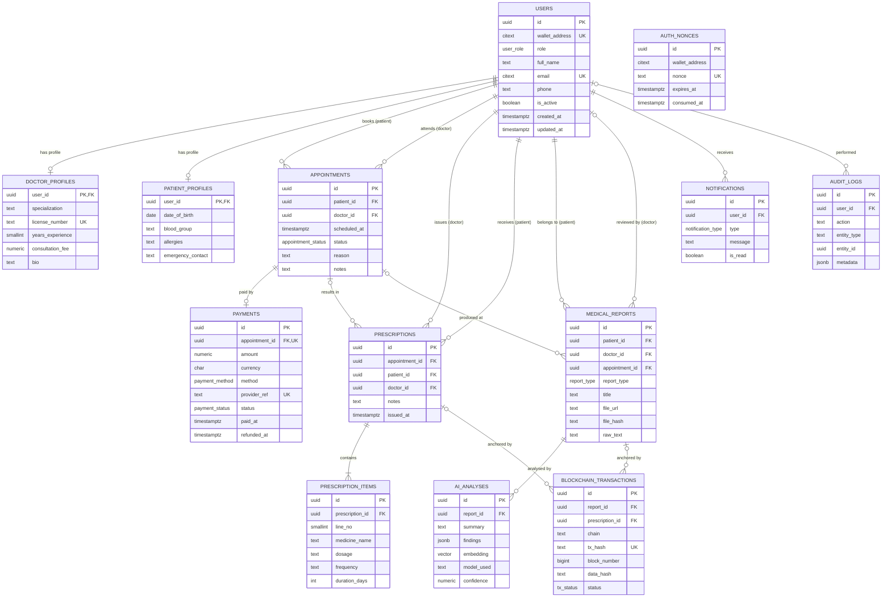

# ELIXOR — Database Design

This document covers the design side of the project: the ER diagram, the relational schema derived from it, the data dictionary, normalization, and the database objects (constraints, indexes, views, triggers, stored procedure, transactions, security).

- **DBMS:** PostgreSQL 17 (hosted on Supabase)
- **ORM:** Prisma 6 (`backend/prisma/schema.prisma`)
- **Schema source of truth:** `db/migrations/001` … `012` (bundled in `db/ALL_IN_ONE_SETUP.sql`)

---

## 1. Entities and relationships

### Primary entities

| Entity | Table | Description |
|---|---|---|
| **User** | `users` | Every person who signs in. Patients, doctors and admins share this one table; the `role` column tells them apart. |
| **Appointment** | `appointments` | A visit a patient books with a doctor. |
| **Medical Report** | `medical_reports` | A lab result, scan or note uploaded for a patient. |
| **Prescription** | `prescriptions` | Medicines a doctor issues to a patient. |
| **Payment** | `payments` | The consultation fee paid for an appointment. |

### Supporting entities

| Entity | Table | Kind |
|---|---|---|
| Doctor Profile | `doctor_profiles` | 1:1 specialization of User (role = doctor) |
| Patient Profile | `patient_profiles` | 1:1 specialization of User (role = patient) |
| Prescription Item | `prescription_items` | Weak entity, identified by (prescription, line_no) |
| AI Analysis | `ai_analyses` | AI summary of a report |
| Blockchain Transaction | `blockchain_transactions` | On-chain anchor of a report or prescription hash |
| Notification | `notifications` | Message shown to one user |
| Audit Log | `audit_logs` | Append-only change history written by triggers |
| Auth Nonce | `auth_nonces` | One-time challenge for wallet sign-in |

### Relationships

| # | Relationship | Between | Cardinality | Participation |
|---|---|---|---|---|
| R1 | **books** | User (patient) → Appointment | 1 : N | Appointment total |
| R2 | **attends** | User (doctor) → Appointment | 1 : N | Appointment total |
| R3 | **pays for** | Appointment → Payment | 1 : 0..1 | Payment total |
| R4 | **issues** | User (doctor) → Prescription | 1 : N | Prescription total |
| R5 | **receives** | User (patient) → Prescription | 1 : N | Prescription total |
| R6 | **results in** | Appointment → Prescription | 1 : N (optional) | Partial |
| R7 | **contains** | Prescription → Prescription Item | 1 : N (identifying) | Item total |
| R8 | **belongs to** | User (patient) → Medical Report | 1 : N | Report total |
| R9 | **reviewed by** | User (doctor) → Medical Report | 1 : N (optional) | Partial |
| R10 | **analysed by** | Medical Report → AI Analysis | 1 : N | Analysis total |
| R11 | **anchored by** | Medical Report / Prescription → Blockchain Transaction | 1 : N | Transaction total (exactly one parent) |
| R12 | **has profile** | User → Doctor Profile / Patient Profile | 1 : 0..1 | Profile total |
| R13 | **notified by** | User → Notification | 1 : N | Notification total |
| R14 | **performed** | User → Audit Log | 1 : N (optional) | Partial |

---

## 2. ER diagram

Crow's-foot notation (rendered by GitHub / any Mermaid viewer). `||` = exactly one, `o|` = zero or one, `|{` = one or more, `o{` = zero or more.



---

## 3. Relational schema

Derived from the ER diagram: each entity becomes a table, each 1:N relationship becomes a foreign key on the N side, each 1:1 specialization shares the parent's key, and the weak entity Prescription Item takes its owner's key plus a line number. Primary keys are **bold**, foreign keys are *italic*.

```
users                  (**id**, wallet_address, role, full_name, email, phone, is_active, created_at, updated_at)
doctor_profiles        (***user_id***→users, specialization, license_number, years_experience, consultation_fee, bio)
patient_profiles       (***user_id***→users, date_of_birth, blood_group, allergies, emergency_contact)
appointments           (**id**, *patient_id*→users, *doctor_id*→users, scheduled_at, status, reason, notes, created_at, updated_at)
payments               (**id**, *appointment_id*→appointments [UNIQUE], amount, currency, method, provider, provider_ref, status, paid_at, refunded_at)
prescriptions          (**id**, *appointment_id*→appointments, *patient_id*→users, *doctor_id*→users, notes, issued_at)
prescription_items     (**id**, *prescription_id*→prescriptions, line_no, medicine_name, dosage, frequency, duration_days)   UNIQUE(prescription_id, line_no)
medical_reports        (**id**, *patient_id*→users, *doctor_id*→users, *appointment_id*→appointments, report_type, title, file_url, file_hash, raw_text, created_at)
ai_analyses            (**id**, *report_id*→medical_reports, summary, findings, embedding, model_used, confidence, created_at)
blockchain_transactions(**id**, *report_id*→medical_reports, *prescription_id*→prescriptions, chain, tx_hash, block_number, data_hash, status, gas_used, created_at, confirmed_at)
notifications          (**id**, *user_id*→users, type, message, is_read, created_at)
audit_logs             (**id**, *user_id*→users, action, entity_type, entity_id, metadata, created_at)
auth_nonces            (**id**, wallet_address, nonce, expires_at, consumed_at, created_at)
```

**13 tables**, every one with a primary key, 17 foreign keys.

### Single users table (RBAC)

All people live in **one** `users` table with a `role` enum (`patient`, `doctor`, `admin`). There are no separate Admin / Doctor / Patient tables. Role-specific attributes sit in the 1:1 tables `doctor_profiles` and `patient_profiles`, so `users` has no columns that are NULL for whole roles. A trigger (`trg_check_appt_roles`) checks that an appointment's `doctor_id` really is a doctor and `patient_id` a patient.

---

## 4. Data dictionary

PK = primary key, FK = foreign key, UK = unique, NN = NOT NULL.

### users
| Column | Type | Constraints | Description |
|---|---|---|---|
| id | uuid | PK, default `gen_random_uuid()` | User id |
| wallet_address | citext | UK, CHECK `^0x[a-f0-9]{40}$` | Ethereum address (email accounts get a derived placeholder) |
| role | user_role | NN, default `patient` | `patient` / `doctor` / `admin` |
| full_name | text | NN | Display name |
| email | citext | UK | Login email (case-insensitive) |
| phone | text | | Contact number |
| is_active | boolean | NN, default `true` | False = deactivated by an admin |
| created_at / updated_at | timestamptz | NN, default `now()` | `updated_at` maintained by trigger |

### doctor_profiles
| Column | Type | Constraints | Description |
|---|---|---|---|
| user_id | uuid | PK, FK → users ON DELETE CASCADE | The doctor |
| specialization | text | NN | e.g. Cardiology |
| license_number | text | NN, UK | Medical licence |
| years_experience | smallint | CHECK ≥ 0 | |
| consultation_fee | numeric(10,2) | CHECK ≥ 0 | Fee charged per visit (INR) |
| bio | text | | |

### patient_profiles
| Column | Type | Constraints | Description |
|---|---|---|---|
| user_id | uuid | PK, FK → users ON DELETE CASCADE | The patient |
| date_of_birth | date | | |
| blood_group | text | CHECK in (A±, B±, AB±, O±) | |
| allergies | text | | Shown to the patient's doctors |
| emergency_contact | text | | |

### appointments
| Column | Type | Constraints | Description |
|---|---|---|---|
| id | uuid | PK | |
| patient_id | uuid | NN, FK → users ON DELETE CASCADE | Who booked |
| doctor_id | uuid | NN, FK → users ON DELETE CASCADE | Who is seen |
| scheduled_at | timestamptz | NN | Visit time |
| status | appointment_status | NN, default `requested` | requested → confirmed → completed / cancelled / no_show |
| reason | text | | Patient's reason |
| notes | text | | System/doctor notes |
| created_at / updated_at | timestamptz | NN | |
| — | | CHECK `patient_id <> doctor_id` | |

### payments
| Column | Type | Constraints | Description |
|---|---|---|---|
| id | uuid | PK | |
| appointment_id | uuid | NN, UK, FK → appointments ON DELETE CASCADE | One payment per visit |
| amount | numeric(10,2) | NN, CHECK > 0 | Fee at payment time |
| currency | char(3) | NN, default `INR` | |
| method | payment_method | NN | `upi` / `card` / `netbanking` |
| provider | text | NN, default `simulated` | No real gateway |
| provider_ref | text | NN, UK | Receipt number |
| status | payment_status | NN, default `paid` | `paid` / `refunded` |
| paid_at | timestamptz | NN | |
| refunded_at | timestamptz | CHECK set iff status = refunded | |

### prescriptions
| Column | Type | Constraints | Description |
|---|---|---|---|
| id | uuid | PK | |
| appointment_id | uuid | FK → appointments ON DELETE SET NULL | Optional linked visit |
| patient_id | uuid | NN, FK → users | |
| doctor_id | uuid | NN, FK → users | |
| notes | text | | Instructions |
| issued_at | timestamptz | NN | |
| — | | CHECK `patient_id <> doctor_id`; trigger: must match the linked appointment | |

### prescription_items
| Column | Type | Constraints | Description |
|---|---|---|---|
| id | uuid | PK | |
| prescription_id | uuid | NN, FK → prescriptions ON DELETE CASCADE | Owner |
| line_no | smallint | NN, CHECK > 0, UK with prescription_id | Order on the prescription |
| medicine_name | text | NN, CHECK not blank | |
| dosage | text | NN | e.g. 500mg |
| frequency | text | NN | e.g. twice daily |
| duration_days | integer | NN, CHECK > 0 | |

### medical_reports
| Column | Type | Constraints | Description |
|---|---|---|---|
| id | uuid | PK | |
| patient_id | uuid | NN, FK → users ON DELETE CASCADE | |
| doctor_id | uuid | FK → users ON DELETE SET NULL | Assigned doctor |
| appointment_id | uuid | FK → appointments ON DELETE SET NULL | |
| report_type | report_type | NN, default `other` | lab_result, imaging, … |
| title | text | NN | |
| file_url | text | NN | Path in private Storage bucket |
| file_hash | text | NN, CHECK 64 hex chars | SHA-256 of the file |
| raw_text | text | | Text used for the AI summary |
| created_at | timestamptz | NN | |

### ai_analyses
| Column | Type | Constraints | Description |
|---|---|---|---|
| id | uuid | PK | |
| report_id | uuid | NN, FK → medical_reports ON DELETE CASCADE | |
| summary | text | NN | |
| findings | jsonb | NN, default `{}` | Model output: flags, severity, recommendation |
| embedding | vector(1536) | | For similarity search (pgvector) |
| model_used | text | NN | |
| confidence | numeric(4,3) | CHECK 0–1 | |

### blockchain_transactions
| Column | Type | Constraints | Description |
|---|---|---|---|
| id | uuid | PK | |
| report_id | uuid | FK → medical_reports ON DELETE CASCADE | |
| prescription_id | uuid | FK → prescriptions ON DELETE CASCADE | |
| chain | text | NN | `hardhat-local` / `sepolia` |
| tx_hash | text | NN, UK | |
| block_number | bigint | | |
| data_hash | text | NN | Hash that was anchored |
| status | tx_status | NN | pending / confirmed / failed |
| gas_used | numeric(20,0) | | |
| — | | CHECK exactly one of report_id / prescription_id | |

### notifications
| Column | Type | Constraints | Description |
|---|---|---|---|
| id | uuid | PK | |
| user_id | uuid | NN, FK → users ON DELETE CASCADE | Recipient |
| type | notification_type | NN | appointment / report / prescription / system |
| message | text | NN | |
| is_read | boolean | NN, default `false` | |

### audit_logs
| Column | Type | Constraints | Description |
|---|---|---|---|
| id | uuid | PK | |
| user_id | uuid | FK → users ON DELETE SET NULL | Who made the change (set per transaction) |
| action | text | NN | INSERT / UPDATE / DELETE |
| entity_type | text | NN | Table name |
| entity_id | uuid | NN | Row id |
| metadata | jsonb | NN | Old and new row |

### auth_nonces
| Column | Type | Constraints | Description |
|---|---|---|---|
| id | uuid | PK | |
| wallet_address | citext | NN | |
| nonce | text | NN, UK | One-time value |
| expires_at | timestamptz | NN | 5 minutes after issue |
| consumed_at | timestamptz | | Set when used |

---

## 5. Normalization (3NF / BCNF)

All tables use a surrogate `uuid` primary key, so every non-key attribute depends on the whole key (no partial dependencies → **2NF**). The work is in removing repeating groups (1NF) and transitive dependencies (3NF).

| Table | Key functional dependencies | Normal form |
|---|---|---|
| users | id → all; email → id; wallet_address → id | BCNF (every determinant is a candidate key) |
| doctor_profiles | user_id → all; license_number → user_id | BCNF |
| patient_profiles | user_id → all | BCNF |
| appointments | id → patient_id, doctor_id, scheduled_at, status, … | BCNF |
| payments | id → all; appointment_id → id; provider_ref → id | BCNF |
| prescriptions | id → all | BCNF (see note) |
| prescription_items | id → all; (prescription_id, line_no) → id | BCNF |
| medical_reports | id → all | BCNF |
| ai_analyses, blockchain_transactions, notifications, audit_logs, auth_nonces | id → all (tx_hash, nonce are also keys) | BCNF |

### Changes made to reach 3NF (migration 012)

1. **Repeating group removed (1NF).** `prescriptions.medications` held a JSON array of medicines. Each medicine is now a row in `prescription_items(prescription_id, line_no, …)`.
2. **Transitive dependency removed (3NF).** `payments` stored `patient_id` and `doctor_id`, but `appointment_id` is NOT NULL and UNIQUE in `payments`, and `appointment_id → patient_id, doctor_id` in `appointments`. So `payments.id → appointment_id → patient_id` was transitive. Both columns were dropped; queries reach the patient and doctor through the appointment.

### Design decisions kept on purpose

- **`prescriptions.patient_id / doctor_id`** stay because `appointment_id` is *optional* (a prescription can be issued without a visit), so `appointment_id` does not determine them in general. When an appointment is linked, trigger `trg_check_prescription_appointment` makes sure they match, so no inconsistency can arise.
- **`payments.amount`** is a snapshot of the fee at payment time, not a copy of `doctor_profiles.consultation_fee`; the fee can change later without changing past payments.
- **JSONB columns** (`ai_analyses.findings`, `audit_logs.metadata`) hold model output and row snapshots that are stored and displayed as a whole, never queried by part, so they are treated as single atomic values.

---

## 6. Constraints

| Kind | Examples |
|---|---|
| PRIMARY KEY | every table (`id`, or `user_id` for profiles) |
| FOREIGN KEY | 17, with CASCADE / SET NULL chosen per relationship |
| NOT NULL | all required attributes (see data dictionary) |
| UNIQUE | `users.email`, `users.wallet_address`, `doctor_profiles.license_number`, `payments.appointment_id`, `payments.provider_ref`, `blockchain_transactions.tx_hash`, `auth_nonces.nonce`, `(prescription_id, line_no)` |
| CHECK | wallet format, blood group list, fee ≥ 0, amount > 0, `patient_id <> doctor_id`, refund time consistency, file hash format, confidence 0–1, exactly one anchor target, duration > 0 |
| DEFAULT | uuids, timestamps, statuses, currency, `is_active` |
| ENUM types | user_role, appointment_status, report_type, tx_status, notification_type, payment_status, payment_method |

## 7. Indexes

| Index | Purpose |
|---|---|
| `idx_appt_patient`, `idx_appt_doctor`, `idx_appt_status`, `idx_appt_scheduled` | Dashboard queries by patient/doctor, status filters, date ordering |
| `idx_reports_patient`, `idx_reports_doctor`, `idx_reports_type`, `idx_reports_created` | Report lists and paging newest-first |
| `idx_presc_patient`, `idx_presc_doctor`, `idx_presc_issued` | Prescription lists and paging |
| `idx_payments_status` | Revenue aggregates |
| `idx_btx_report`, `idx_btx_prescription`, `idx_btx_status` | Anchor lookups |
| `idx_notif_user`, `idx_notif_user_created` | Unread badge, newest-first list |
| `idx_users_role`, `idx_users_full_name_trgm`, `idx_users_email_trgm` | Admin user list filtering and `ILIKE '%term%'` search (pg_trgm GIN) |
| `idx_audit_entity`, `idx_audit_user`, `idx_audit_created` | Audit trail lookups |
| `idx_ai_embedding` (IVFFlat) | Vector similarity search |
| `idx_auth_nonces_wallet`, `idx_auth_nonces_expiry` (partial) | Sign-in challenge lookup |

## 8. Views (joins and aggregates)

| View | What it does | Used by |
|---|---|---|
| `v_patient_dashboard` | Joins appointments ⋈ users (doctor) ⟕ doctor_profiles | `GET /api/appointments` (patient) |
| `v_doctor_dashboard` | Joins appointments ⋈ users (patient) + correlated COUNT of reports | `GET /api/appointments` (doctor) |
| `v_report_with_analysis` | Report ⟕ latest AI analysis ⟕ latest anchor (LATERAL joins) | `GET /api/reports` |
| `v_admin_analytics` | COUNT, SUM, AVG over every table (revenue, refunds, anchors, …) | `GET /api/admin/analytics` |
| `v_doctor_weekly_load` | GROUP BY doctor, week with COUNT … FILTER | `GET /api/admin/doctor-load` |

## 9. Triggers

| Trigger | Table / event | Effect |
|---|---|---|
| `trg_users_updated_at`, `trg_appointments_updated_at` | BEFORE UPDATE | Maintain `updated_at` |
| `trg_audit_*` | AFTER INSERT/UPDATE/DELETE on reports, prescriptions, appointments, payments; role changes | Write `audit_logs` with the acting user |
| `trg_notify_appointment` | AFTER INSERT/UPDATE on appointments | Notify doctor of a request / patient of a status change |
| `trg_notify_report`, `trg_notify_prescription` | AFTER INSERT | Notify the patient |
| `trg_check_appt_roles` | BEFORE INSERT/UPDATE on appointments | Doctor/patient role check |
| `trg_refund_on_cancel` | AFTER UPDATE OF status on appointments | Cancelling a paid visit refunds it |
| `trg_check_prescription_appointment` | BEFORE INSERT/UPDATE on prescriptions | Linked appointment must match patient and doctor |

## 10. Stored procedure

`sp_create_prescription(p_doctor_id, p_patient_id, p_appointment_id, p_notes, p_items jsonb, INOUT p_prescription_id)` — validates the input, inserts the prescription header and one `prescription_items` row per medicine, and returns the new id. Called from `POST /api/prescriptions` via Prisma:

```ts
await tx.$queryRaw`call sp_create_prescription(${me}::uuid, ${patientId}::uuid, ${apptId}::uuid, ${notes}, ${items}::jsonb, null)`;
```

Also: `match_patient_analyses(...)` (SQL function, vector similarity search), `fn_current_user_id()` / `fn_current_user_role()` (RLS helpers).

## 11. Transactions

All multi-step writes run in one transaction (`prisma.$transaction`), so they commit or roll back together. `withAuditUser()` (`backend/src/config/prisma.ts`) also sets `app.current_user_id` for the transaction so the audit trigger knows who acted.

| Operation | Steps in one transaction | File |
|---|---|---|
| Doctor registration | INSERT users + INSERT doctor_profiles | `routes/auth.routes.ts` |
| Pay for a visit | `SELECT … FOR UPDATE` on the appointment, check status and existing payment, INSERT payment | `routes/payments.routes.ts` |
| Issue prescription | CALL `sp_create_prescription` (header + items), read back | `routes/prescriptions.routes.ts` |
| Deactivate a user | INSERT notifications, UPDATE users, UPDATE appointments (refund trigger fires inside) | `routes/admin.routes.ts` |
| Delete a doctor | INSERT notifications, DELETE users (cascades) | `routes/admin.routes.ts` |
| Change appointment status | SELECT (ownership check) + UPDATE (refund/notify triggers) | `routes/appointments.routes.ts` |

## 12. Security

- **Authentication:** JWT issued by the backend after email/password login (Supabase Auth stores **bcrypt** password hashes) or wallet signature (SIWE-style nonce).
- **Authorization (RBAC):** `requireRole()` middleware on API routes; every Prisma query is scoped with a `where` built from the signed-in user; the frontend shows each role only its own dashboard.
- **Row-level security:** policies in migration 004/008/012 restrict rows per user for any client that connects with a user token (defence in depth).
- **SQL injection:** all queries go through Prisma's parameterised query builder; raw queries use tagged templates (`$queryRaw\`…${value}\``), which send values as bind parameters.
- **Secrets:** read from `.env` with `dotenv`; `.env*` files are git-ignored.

## 13. ORM mapping

Each table above has a model in `backend/prisma/schema.prisma` with its relations named after the ER relationships (e.g. `users.appointments_as_patient`, `prescriptions.items`, `appointments.payment`). Views and the stored procedure are reached through Prisma's parameterised raw queries, which is where the brief allows raw SQL.
