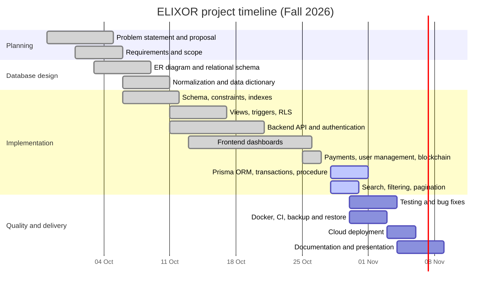

# Project Proposal — ELIXOR

**Course:** Database Systems (BCSE307L) · Fall Semester 2026–27
**Faculty:** Dr. Deepika J
**Slot / Class:** [L11+L12 or L43+L44] · [Class number]

---

## 1. Project title

**ELIXOR — A Healthcare Management System with a Normalized Relational Database, Role-Based Access and Tamper-Evident Medical Records**

## 2. Problem statement

Small clinics and independent doctors often keep appointments, prescriptions, lab reports and payments in separate notebooks, spreadsheets and messaging apps. This causes:

- double-booked or forgotten appointments, and no single history per patient;
- prescriptions and reports that can't be found, or can be altered without anyone noticing;
- no control over who may see which patient's records;
- no reliable view of revenue, refunds or doctor workload.

ELIXOR stores all of this in one relational database (PostgreSQL) designed to third normal form, with integrity enforced by keys, constraints and triggers, secure role-based access for patients, doctors and administrators, and analytics built from SQL views. Report and prescription hashes can additionally be anchored on a blockchain so any later change to a record is detectable.

## 3. Objectives

1. Design an ER model and a relational schema (≥ 4 primary entities, ≥ 3 relationships, ≥ 8 tables) normalized to 3NF/BCNF.
2. Implement the schema in PostgreSQL with primary/foreign keys, NOT NULL, UNIQUE, CHECK and DEFAULT constraints and supporting indexes.
3. Implement joins, aggregate queries, views, transactions, a stored procedure and triggers.
4. Access the database from an Express.js backend through the Prisma ORM.
5. Build a responsive Next.js application with login, role dashboards, CRUD, search, filtering, pagination, form validation and error handling.
6. Secure the system with JWT authentication, RBAC on a single Users table, hashed passwords, SQL-injection-safe queries and secrets kept in environment files.
7. Follow professional practice: GitHub with branches and meaningful commits, database backup and restore with `pg_dump`/`pg_restore`, Docker images and cloud deployment.

## 4. Scope

**In scope**

- Patients: register/login, maintain a health profile (allergies, blood group), book appointments with doctors filtered by specialization, pay the consultation fee (simulated), view prescriptions and reports, upload reports and receive AI summaries.
- Doctors: accept/decline/complete appointments, see patient allergies, issue multi-medicine prescriptions.
- Admins: dashboard with platform-wide aggregates and weekly doctor load; search, filter, deactivate or delete users.
- Database: 13 tables, 5 views, 10+ triggers, 1 stored procedure, row-level security policies, audit trail.
- Integrity: SHA-256 hashes of reports/prescriptions anchored on a local Ethereum chain or Sepolia testnet.

**Out of scope**

- Real payment gateways (payments are simulated; no card data is collected).
- Clinical decision making (AI summaries are informational only).
- Hospital-scale features such as inventory, wards or insurance claims.

## 5. Team members and responsibilities

| Member | Register No. | Responsibilities |
|---|---|---|
| [Name 1] | [Reg No] | Database design: ER diagram, relational schema, normalization, data dictionary; SQL migrations, views, triggers, stored procedure |
| [Name 2] | [Reg No] | Backend: Express.js API, Prisma ORM integration, transactions, authentication and RBAC |
| [Name 3] | [Reg No] | Frontend: Next.js dashboards, forms and validation, search/filter/pagination, responsive UI |
| [Name 4] | [Reg No] | DevOps and testing: GitHub workflow, Docker, CI, backup/restore, deployment; blockchain anchoring and smart-contract tests |

*(Edit to match the actual team size and split.)*

## 6. Technology stack

| Layer | Technology |
|---|---|
| Frontend | Next.js 14 (React 18, TypeScript), Tailwind CSS, Recharts |
| Backend | Node.js 20, Express.js 4, TypeScript, Zod (validation) |
| ORM | Prisma 6 |
| Database | PostgreSQL 17 (Supabase managed cloud database), pg_trgm, pgvector |
| Authentication | JWT (jsonwebtoken), Supabase Auth (bcrypt password hashes), wallet signature login |
| Authorization | Role-based middleware + Postgres row-level security |
| Blockchain | Solidity 0.8.24, Hardhat, ethers.js |
| AI | Local LLM via Ollama |
| DevOps | Git/GitHub, GitHub Actions CI, Docker, Docker Compose |
| Deployment | Render (backend), Vercel (frontend), Supabase (database) |

## 7. Major deliverables

1. ER diagram, relational schema and data dictionary — `docs/DATABASE_DESIGN.md`
2. SQL implementation — `db/migrations/001–012`, `db/ALL_IN_ONE_SETUP.sql`, seed data
3. Backend API with Prisma ORM — `backend/`
4. Frontend web application — `frontend/`
5. Smart contract and tests — `contracts/`
6. Backup and restore scripts — `scripts/db-backup.sh`, `scripts/db-restore.sh`
7. Dockerfiles, `docker-compose.yml`, CI workflow
8. README with installation and execution steps; live deployment URL
9. This proposal and the final presentation

## 8. Project timeline

| Phase | Start | End | Status |
|---|---|---|---|
| Planning and proposal | 28 Sep | 06 Oct | Done |
| Database design | 03 Oct | 11 Oct | Done |
| Schema, views, triggers, RLS | 06 Oct | 17 Oct | Done |
| Backend and frontend | 11 Oct | 26 Oct | Done |
| ORM, transactions, stored procedure, pagination | 28 Oct | 31 Oct | In progress |
| Testing, Docker, CI, backup | 30 Oct | 04 Nov | Planned |
| Deployment, documentation, presentation | 03 Nov | 09 Nov | Planned |
